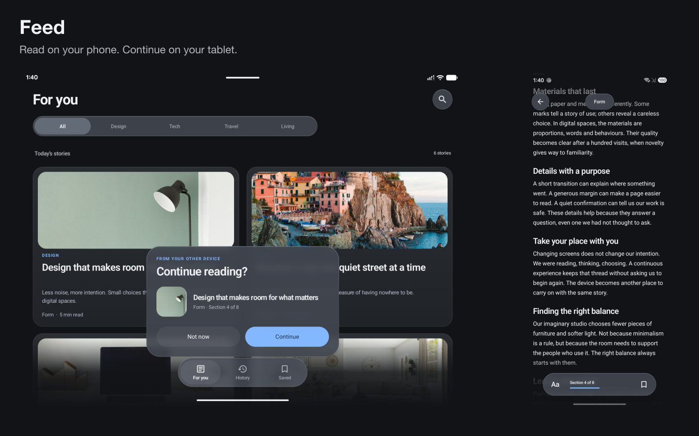
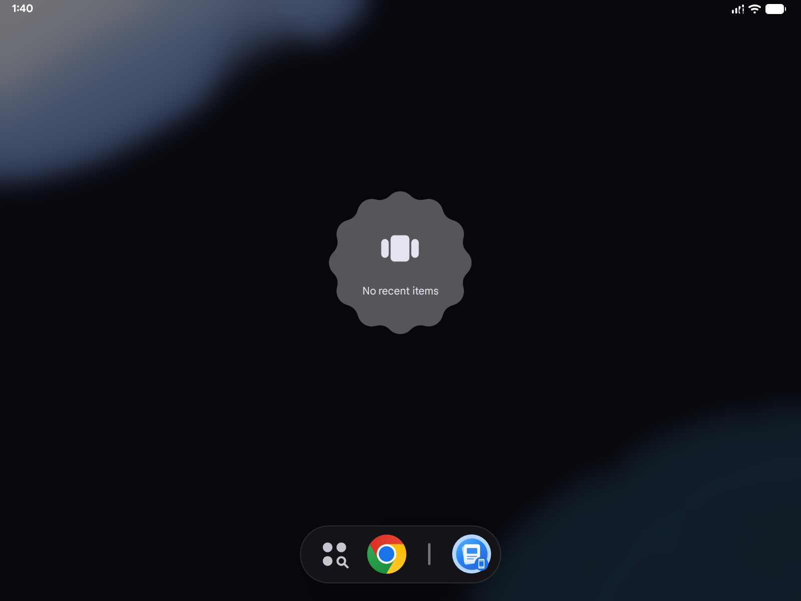
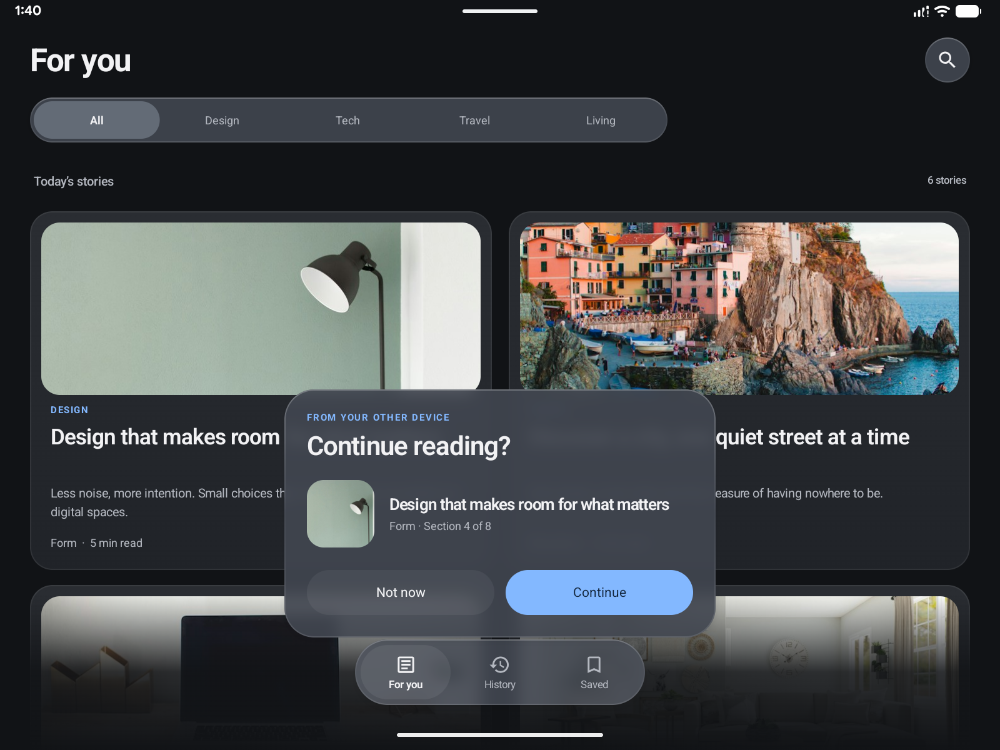

# Feed · Android 17 Handoff

Start reading on a phone. Select Feed from the tablet’s **Continue On** suggestion, then choose **Continue** to resume the same article and section.

Feed is a small Kotlin and Jetpack Compose sample for the Android 17 Activity Handoff APIs. It includes six fictional articles, an adaptive feed, a reader, saved stories and an explicit confirmation before replacing the current reading. It has no backend or app account.

## Try the sample

[Download Feed 0.2 APK](https://github.com/lucf15/android17-handoff-sample/releases/download/v0.2.0/feed-sample-0.2.apk) · [SHA-256 checksum](https://github.com/lucf15/android17-handoff-sample/releases/download/v0.2.0/SHA256SUMS)

The APK requires **Android 17 / API 37**. It is an optimized sample build signed with a development certificate. Install the same APK on both devices. Its application ID is `it.lucf15`.

Reading locally works immediately. Cross-device continuation additionally requires compatible, configured devices and the system’s Continue On entry point. Installing this app alone does not enable that system feature.

## Continue on a tablet

1. Prepare both devices using Google’s [setup and test guide](https://developer.android.com/develop/better-together/continue-on/setup).
2. On the **phone**, open Feed, select a story and scroll to a later section. Leave that article open.
3. On the **tablet**, open **Recent apps / Overview** to reveal the taskbar. Look for the Feed suggestion with a small phone badge. It is distinct from a normal installed-app shortcut.
4. Tap the suggestion. Feed opens a floating **Continue reading?** confirmation showing the article and section.
5. Choose **Continue**. The reader restores that section. Choose **Not now** to keep the current reading instead.

The tablet app can be closed before the handoff. Opening Feed from its normal launcher icon does not discover a remote session. The system owns discovery and intent delivery; the app owns validation, confirmation and restoration.

If the suggestion is missing, check the device requirements, cross-device settings and taskbar support in Google’s guide. A missing system suggestion does not, by itself, indicate an error in the app’s payload.

## See the flow







The reading position is a **section**, not a pixel offset. The same section wraps differently on a phone and tablet. The visible counter is one-based; the transferred index is zero-based.

## How it works

| Responsibility | Source |
| --- | --- |
| Activity callbacks and incoming intents | [MainActivity](app/src/main/java/it/lucf15/MainActivity.kt) |
| Enable Handoff, create a bundle, decode an incoming offer | [HandoffAdapter](app/src/main/java/it/lucf15/platform/HandoffAdapter.kt) |
| Reject unknown articles and invalid sections or sessions | [ValidateReading](app/src/main/java/it/lucf15/domain/usecase/ValidateReading.kt) |
| Open, accept, dismiss and restore reading state | [ReaderViewModel](app/src/main/java/it/lucf15/ui/reader/ReaderViewModel.kt) |
| Render the incoming offer | [ContinueBanner](app/src/main/java/it/lucf15/ui/reader/ContinueBanner.kt) |

An open article opts its Activity into Handoff through `setHandoffEnabled`. When Android calls `onHandoffActivityDataRequested`, the adapter returns `HandoffActivityData` containing the article ID, section index and reading session in a `PersistableBundle`. The destination handles both its initial intent and `onNewIntent`.

A valid offer becomes pending state. Only **Continue** restores it. ViewModels expose read-only snapshot state; related updates are atomic. `SavedStateHandle` retains the reading and pending offer for state restoration. Repository streams own saved stories, reading history and text-size preferences.

The catalog is bundled on both devices. No article text is sent. Session identifiers correlate reading state and are not authentication credentials. A production app needs its own content retrieval, authorization and unavailable-content handling.

## Interface

- One, two or three feed columns according to available width; a bounded reading column on tablets.
- App-owned colors and typography with system light and dark appearance.
- Edge-to-edge content, fixed search and category controls, floating glass surfaces, shadows and top/bottom fades.
- Compose graphics-layer backdrop blur and tint, with no vendor UI dependencies.
- Cupertino-style overscroll adapted from Compose Multiplatform; see [third-party notices](THIRD_PARTY_NOTICES.md).
- Directional 360 ms transitions between feed and reader using `AnimatedContent`. This sample does not use a Navigation NavHost or implement interactive predictive-back progress.

## Build and verify

Use **JDK 21** and **Android SDK 37**. Set `ANDROID_HOME`, or set `sdk.dir` in an untracked `local.properties`.

```sh
./gradlew :app:assembleDebug
```

Install `app/build/outputs/apk/debug/app-debug.apk`. Release builds are unsigned by default; provide a signing configuration for your own distribution.

```sh
./gradlew :app:assembleRelease :app:assembleDebugAndroidTest :app:lintDebug
adb -s DEVICE_SERIAL install -r app/build/outputs/apk/debug/app-debug.apk
adb -s DEVICE_SERIAL install -r app/build/outputs/apk/androidTest/debug/app-debug-androidTest.apk
adb -s DEVICE_SERIAL shell am instrument -w it.lucf15.test/it.lucf15.HandoffReaderTestRunner
```

The instrumentation runner checks confirmation, dismissal, cold/warm intent delivery, payloads, invalid positions and Handoff eligibility. These synthetic checks are separate from the complete two-device flow through the system suggestion.

For a manual end-to-end check, compare `DATA_REQUEST`, `OFFER` and `RESTORED` in the `HandoffSample` log tag. The article, section and session should match. Verify the section in the reader too, then repeat with **Not now** and with the receiving app already open.

Kotlin source is formatted with four-space indentation. The repository contains application code and app screenshots; editorial article assets are maintained separately.

## Official Android guides

- [Continue On overview](https://developer.android.com/develop/better-together/continue-on): supported journeys and system responsibilities.
- [Enable and customize cross-device Handoff](https://developer.android.com/develop/better-together/continue-on/enable-support): Activity APIs and handoff data.
- [Set up and test](https://developer.android.com/develop/better-together/continue-on/setup): device preparation and the tablet taskbar entry point.

## Assets and libraries

Article photographs are from Unsplash; URLs are listed in [image sources](docs/image-sources.json). Article text is fictional. The app uses AndroidX Compose, Activity and Lifecycle, Material vector icons and Coil for local image decoding. Its theme and controls are app-owned. See [third-party notices](THIRD_PARTY_NOTICES.md) for the adapted overscroll implementation.
